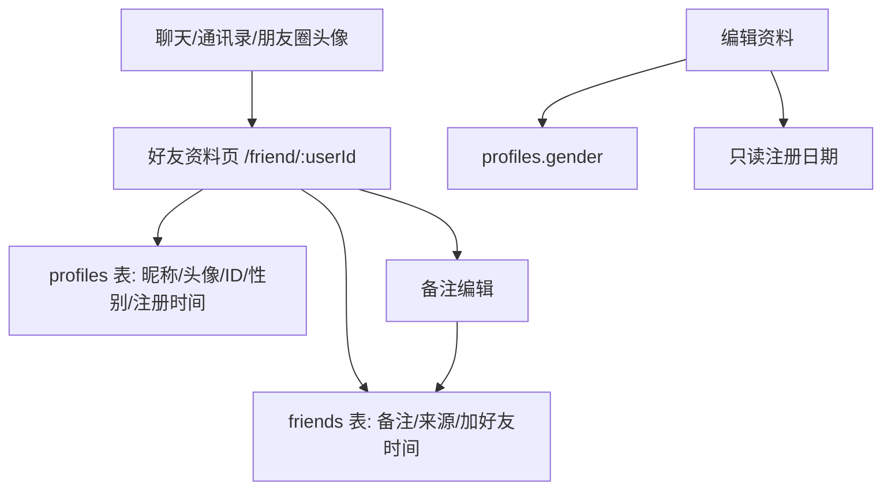

# 好友资料详情与个人资料扩展

Feature Name: 2026-11-21-friend-profile-details
Updated: 2026-11-21

## Description

补齐好友资料页的备注、性别、加好友时间与方式、来纸墨天数，并让聊天、通讯录、朋友圈的头像统一进入好友资料页。个人编辑资料新增性别设置与只读注册日期。

备注按好友关系所有者存储，仅本人可见。加好友方式在好友请求创建时记录，请求接受后写入双向好友关系。性别存放在公开资料表，好友资料页实时展示。来纸墨天数由注册时间派生，不单独存储。

## Architecture



## Components and Interfaces

- `src/lib/profileMeta.js`：性别选项与文案、注册日期格式化、来纸墨天数、加好友方式文案。
- `src/lib/friends.js`：`mapFriend` 输出备注与来源；新增 `updateFriendRemark(ownerId, friendId, remark)`；`upsertFriend` 支持写入来源。
- `src/lib/friendRequests.js`：请求记录 `source`；`sendFriendRequest` 接收来源；接受请求时把来源写入好友关系。
- `src/lib/profiles.js`：`mapProfile` 输出 `gender`；新增 `updateProfileGender(userId, gender)`。
- `src/store.jsx`：好友元数据随好友同步进入本地状态；新增 `friendMetaOf`、`displayNameOf`、`setFriendRemark`。
- `src/pages/FriendProfile.jsx`：展示并编辑备注，展示性别、加好友日期与方式、来纸墨天数。
- `src/pages/EditProfile.jsx`：性别单选与只读注册日期。
- `src/pages/ChatDetail.jsx`、`Contacts.jsx`、`Discover.jsx`、`FriendMoments.jsx`：头像入口与备注称呼。

## Data Models

### profiles 新增字段

| 字段 | 类型 | 说明 |
| --- | --- | --- |
| gender | text not null default 'secret' | male / female / secret |

### friends 新增字段

| 字段 | 类型 | 说明 |
| --- | --- | --- |
| remark | text | 好友所有者私有备注，最多 20 字 |
| source | text | id / email / phone / recommend |

### friend_requests 新增字段

| 字段 | 类型 | 说明 |
| --- | --- | --- |
| source | text | 发送请求时的搜索来源 |

### 客户端好友元数据

```js
{
  userId: '当前用户 UUID',
  friendId: '好友 UUID',
  createdAt: '2026-11-21T10:00:00Z',
  source: 'id',
  remark: '老李'
}
```

## Correctness Properties

- 备注更新只作用于 `owner_id = 当前用户 AND friend_id = 好友` 的好友关系行。
- `friends` 表的 SELECT 策略仅允许读取本人持有的行，备注与来源不会通过接口暴露给对方。
- 来纸墨天数为正整数，注册当天为 1；注册时间缺失或非法时返回 `null`。
- 性别取值限定为 `male`、`female`、`secret`，非法值回退为 `secret`。
- 历史好友缺少来源时展示“未知”。

## Error Handling

- 云端缺少 `friends.remark` 列时，备注保存在本机好友状态并提示执行云初始化 SQL。
- 云端缺少 `profiles.gender` 列时，性别保存在本机并提示执行云初始化 SQL。
- 好友请求写入来源失败时，回退为不带来源的请求，保持加好友流程可用。
- 好友资料读取失败时继续使用本地缓存并显示原有错误提示。

## Test Strategy

- 单元测试：性别规范化与文案、注册天数边界、加好友方式文案、备注规范化、好友字段映射。
- 页面测试：好友资料页备注保存与展示、性别与来源展示、编辑资料性别保存与注册日期只读、头像跳转。
- 回归：通讯录、聊天、朋友圈现有测试，全量 lint/test/build。
